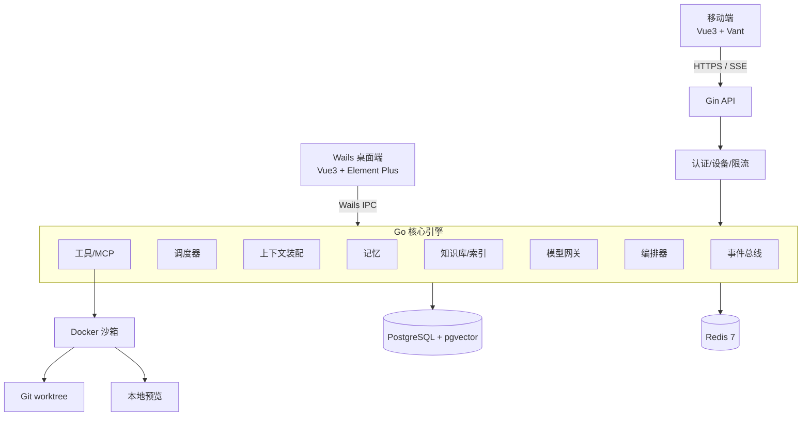

# 架构设计

## 1. 总体架构



### 运行方式

- 单进程内嵌服务：Wails 桌面应用启动时，在同一个 Go 进程中启动核心引擎。
- 桌面端通过 Wails IPC/事件访问核心服务，WebView 不直接访问本地 HTTP。
- 移动端通过 Tailscale 私网访问 HTTPS API。
- Docker 用于开发环境和代码执行沙箱，不要求用户手工安装 PostgreSQL、Redis 等开发依赖。

## 2. 后端模块

```text
backend/
├─ cmd/app/                 # 服务入口
├─ cmd/desktop/             # Wails 桌面入口（后续）
├─ internal/
│  ├─ config/               # 配置
│  ├─ transport/http/       # Gin handler、middleware、DTO
│  ├─ application/          # 用例编排
│  ├─ domain/               # 实体、值对象、端口
│  ├─ infrastructure/       # GORM、Redis、向量库、Docker、模型
│  ├─ agent/                # Agent 配置与运行
│  ├─ orchestrator/         # 状态机、任务 DAG
│  ├─ scheduler/            # 开工窗口、并发、重试
│  ├─ context/              # 上下文装配
│  ├─ memory/               # 记忆治理
│  ├─ knowledge/            # 知识库与增量索引
│  ├─ event/                # 领域事件
│  └─ observability/        # 日志、审计、诊断
├─ migrations/
├─ config/
└─ go.mod
```

依赖方向：

```text
transport -> application -> domain <- infrastructure
```

规则：

- `domain` 不依赖 Gin、GORM、Docker、Milvus、模型 SDK。
- Handler 不直接写数据库。
- 外部服务都通过接口适配。
- 事务边界放在 application 层。

## 3. 数据与存储

| 存储 | 用途 |
|---|---|
| PostgreSQL | 用户、项目、消息、任务、审批、事件、记忆、审计 |
| pgvector | 代码/文档/记忆的向量检索 |
| Redis | Asynq 任务队列、缓存、限流、在线状态 |
| 本地文件系统 | Git 仓库、worktree、构建产物、日志 |
| OS Keychain | API Key、设备私钥、数据库密码 |

原则：PostgreSQL 是事实来源，Redis 和向量索引都可重建。

### 核心实体

已实现：`users`、`sessions`、`projects`、`conversations`、`messages`、`project_profiles`、`requirement_documents`、`tasks`、`task_dependencies`、`agent_runs`、`approvals`。

规划中：`user_preferences`、`devices`、`conversation_digests`、`agent_profiles`、`events`、`artifacts`、`tool_invocations`、`model_usage`、`memory_items`、`knowledge_documents`、`knowledge_chunks`、`sandbox_runs`、`audit_logs`、`tech_packs`。

关键字段补充：

- `messages`: `content_raw`、`summary`、`source_event_id`、`sender_agent_role`、`is_generated_team_feed`。
- `projects`: `working_dir`、`project_mode`、`stack_profile_id`、`output_language`、`execution_policy_id`。
- `user_preferences`: `locale`、`timezone`、`theme_mode`、`theme_id`。
- `devices`: `public_key`、`cert_fingerprint`、`permissions`、`revoked_at`。

## 4. API 与事件

- REST + JSON，前缀 `/api/v1`，只通过 HTTPS 暴露给移动端或可选 Web 客户端。
- 移动端流式事件使用 SSE；WebSocket 仅在确有双向需求时引入。
- 桌面端使用 Wails IPC 适配器调用同一应用服务。
- 写请求支持 `Idempotency-Key`。
- 统一错误结构：`code`、`message`、`request_id`、`details`。
- OpenAPI 作为契约源，生成移动端 Axios Client 和桌面端 IPC Client 的类型。

主要资源：

```text
/auth/login /auth/refresh /auth/logout
/me /me/preferences /devices
/projects /projects/:id /projects/:id/index /workspaces/browse
/conversations/:id/messages /conversations/:id/stream
/tasks/:id /tasks/:id/cancel /tasks/:id/retry /tasks/:id/approve
/artifacts /memory /usage /events
```

事件 envelope：

```json
{
  "id": "evt_01J...",
  "type": "task.status_changed",
  "aggregate_id": "task_01J...",
  "seq": 42,
  "occurred_at": "2026-01-01T10:00:00Z",
  "data": {}
}
```

要求：支持 `Last-Event-ID` 断线续传、项目级订阅、心跳、敏感字段脱敏。
## 5. Agent 编排

### 主 Agent 核心闭环

```text
用户消息 -> 主 Agent 流式回复 -> 需求澄清
        -> PRD 草稿 -> 用户批准
        -> 任务 DAG -> 计划审批 -> 可执行任务
        -> 执行审批 -> 运行记录 -> 验收 -> 完成
```

主 Agent 当前的确定性规划器负责从对话、项目画像和 PRD 生成需求文档与任务 DAG。模型网关接入后保持相同用例边界，只替换生成器。

### 任务状态机

```text
backlog -> ready -> in_progress -> review -> done
   |         |          |            |
   +------ blocked <----+------------+
   +------ cancelled
```

- 任务只有在全部依赖为 `done` 时才从 `backlog` 进入 `ready`。
- `ready -> in_progress` 必须经过任务执行审批。
- 执行完成记录会进入 `review`，验收通过后进入 `done`。
- 执行审批通过后，任务在独立 Docker 沙箱中运行受控命令；运行日志、退出码和变更文件写入 `agent_runs`。
- 沙箱只共享项目工作区，不继承完整聊天记录或宿主机目录。

### 任务信封

执行 Agent 不继承完整聊天记录，只接收：

- 目标和验收标准。
- 项目画像、相关产物、相关文件。
- 允许路径和工具白名单。
- token、步数、时间和输出 Schema 预算。

输出统一为结构化结果：状态、摘要、变更文件、测试结果、风险、下一步。

### 审批门禁

| 门禁 | 内容 |
|---|---|
| G1 | 需求确认：PRD、范围、非目标、验收标准 |
| G2 | 计划确认：任务 DAG、依赖、预算、风险 |
| G3 | 合并确认：Diff、测试、风险 |
| G4 | 部署确认：目标环境、变更、回滚 |

### 团队消息

- 主 Agent 可生成 `team_messages`，营造团队群聊氛围。
- 每条消息必须绑定 `task_id` 或 `event_id`。
- 后端校验事件存在且状态匹配，不能虚构完成结果。
- 用户可以切换 "团队群聊" 和 "简洁模式"。

## 6. 上下文、记忆与知识库

### 上下文装配

```text
任务信封 -> 预算 -> 项目约束 -> 相关产物 -> 混合检索
        -> 依赖扩展 -> 去重排序 -> 压缩 -> 预算校验 -> 上下文清单
```

原则：

- 上下文不是历史记录，而是当前决策的工作集。
- 默认上下文不超过 32K tokens，可配置。
- 工具结果先摘要，再进入上下文。
- 测试日志只保留失败用例、错误栈关键帧和复现命令。
- 超预算时按优先级裁剪，不静默截断。

### 记忆分层

| 层级 | 内容 |
|---|---|
| 用户记忆 | 偏好、语言、主题、常用技术栈 |
| 项目记忆 | 架构决策、编码规范、术语、已知坑 |
| 任务记忆 | 目标、进度、阻塞点 |
| 会话摘要 | 对话压缩结果 |

记忆必须有来源、置信度、作用域、有效期和版本。Agent 只能写候选记忆，长期记忆由整理器或用户确认。

### 知识库

- 初始索引一次，之后按 Git diff、文件监听和 hash 增量更新。
- 使用 tree-sitter/语言工具提取符号，按语义边界切 chunk。
- 混合检索：关键词/符号匹配 + 向量召回 + 依赖扩展 + 重排。
- 禁止全仓塞 prompt、重复全量扫描、索引构建产物和密钥。
- 技术知识用签名 Tech Pack，默认离线；任务中不频繁联网。

## 7. 多技术栈

采用通用编码 Agent：

```text
通用编码 Agent + Stack Profile + Tech Pack + Sandbox Image + 项目约定
```

首批支持：

| 技术栈 | MVP 支持 |
|---|---|
| Go | 构建、测试、格式化、运行、预览 |
| Vue 3 | Vite、Pinia、Vue Router、构建、测试 |
| React | Vite/Next、构建、测试、运行 |
| Node.js | npm/pnpm、构建、测试 |
| Python | uv/pip、pytest、运行 |
| Java | Maven/Gradle、JUnit、构建 |
| .NET | dotnet build/test |
| uni-app | H5 构建和预览；原生打包后续 |

产品自身前端固定 Vue 3，不引入 React 或 uni-app。

## 8. 调度与成本

- `ExecutionWindow`：用户空闲时间，例如工作日 18:00–次日 09:00、节假日全天。
- `CostWindow`：模型供应商低价时段，由可配置价格表提供。
- 策略：`cost_first`、`latency_first`、`balanced`。
- 用户随时可提需求；自动执行受窗口限制，可手动 "立即开工"。
- 09:00 后不启动新任务，运行中任务保存检查点。
- 每次任务展示预计成本，结束后记录实际 token 和费用。

## 9. 安全与沙箱

- 密码使用 Argon2id；会话令牌只存哈希。
- API Key、设备私钥放 OS Keychain。
- 移动设备一次性配对，使用设备公钥签名和短期令牌。
- 远程只监听 Tailscale 接口，TLS 1.3 + 证书固定，可选 mTLS。
- 桌面 WebView 使用 Wails IPC，不直接访问本地 HTTP。
- 生产桌面不向 WebView 提供 HTTP 回退；浏览器调试回退仅用于本地开发。移动端 SSE/WebSocket 同样使用 TLS。
- 代码只在一次性 Docker 沙箱中执行，使用 `cap-drop=ALL` 和 `no-new-privileges`。
- 沙箱默认断网，限制 CPU/内存/PID/时间；根文件系统是容器临时层，项目工作区可写。
- 沙箱只共享项目工作区，不挂载 Docker Socket、用户主目录和密钥；开发后端通过本机 Docker 创建兄弟容器。
- 后续应使用独立 runner 或受限 Docker API 代理缩小后端的 Docker 权限。
- 合并、部署、删除必须人工审批。
- 审计登录、设备、任务、工具调用、审批和部署。

## 10. i18n 与主题

- 前端 `vue-i18n`，按语言懒加载；Element Plus/Vant 使用对应 locale。
- 后端返回稳定错误码和参数，前端负责翻译。
- 所有时间存 UTC，展示用 IANA 时区。
- AI 输出支持对话语言、产物语言、代码注释语言配置。
- 主题使用 CSS Variables 设计 Token，支持深色、浅色、跟随系统、自定义。
- 桌面 Element Plus、移动 Vant 共享主题 Token 和自定义主题 Schema。
- 首屏读取本地缓存主题，避免闪烁。

## 11. 商业化预留

- 首版单用户，但保留 `user_id`、项目成员和审计维度。
- 接口：`EntitlementService`、`QuotaService`、`UsageMeter`、`LicenseService`。
- 模式：免费版 + Pro 订阅/本地授权 + 托管服务。
- BYOK：用户自带 API Key 时不加价 token；平台按功能、席位或高级能力收费。
- 首版只预留接口，不做真实支付。